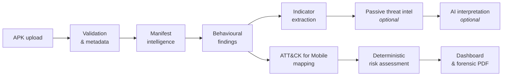

<div align="center">

# MALINT-X

### Evidence-first Android malware analysis and threat intelligence

**Upload an APK. Get a verdict you can defend.**


</div>

---

## Why MALINT-X

Most mobile-malware tooling hands you a score and asks you to trust it. MALINT-X is built the other way around: every finding points back to the evidence that produced it, every score can be explained line by line, and the system says so plainly when it does not know.

> **Evidence first. Intelligence second. AI third.**
> AI can interpret findings. It can never invent evidence and it never sets the verdict.

## What you get from a single APK

| Output | What it contains |
|---|---|
| **Validated metadata** | Integrity-checked package and file information |
| **Manifest intelligence** | Permissions, components, exported surfaces, configuration |
| **Behavioural findings** | Static findings, each linked to supporting evidence |
| **Indicators** | Extracted IOCs for downstream use |
| **Threat intelligence** *(optional, passive)* | Enrichment from external intel sources |
| **AI interpretation** *(optional)* | Plain-language explanation layered on top of the evidence |
| **ATT&CK mapping** | MITRE ATT&CK for Mobile technique mapping |
| **Risk assessment** | Deterministic, explainable, reproducible |
| **Dashboard + forensic PDF** | Interactive review and a shareable report |

## Design principles

- **Static analysis only.** Samples are never executed.
- **Self-contained core.** The core pipeline needs no API key, no network and no Java. Integrations are strictly optional.
- **Deterministic verdicts.** The same input yields the same score, with a visible reasoning trail.
- **Capability ≠ intent ≠ vulnerability.** SMS APIs in a banking app are not malice. Misconfigurations are reported separately and never inflate the risk score.
- **Honest outcomes.** The system can answer "I can't tell you":

| Outcome | Meaning |
|---|---|
| `informational` → `critical` | Graded risk, backed by evidence |
| `inconclusive` | Evidence exists but does not support a confident call |
| `insufficient_evidence` | Not enough signal to assess |
| `analysis_failed` | The pipeline could not complete |

A low score is **not** a safety certificate.

## Pipeline



The diagram shows the logical flow of outputs. See [Architecture](docs/ARCHITECTURE.md) for the authoritative design.

## Quick start

```bash
pip install -r requirements.lock.txt

# API
python -m malintx.api.app

# Dashboard (second terminal)
streamlit run malintx/dashboard/app.py
```

Full instructions: [docs/SETUP.md](docs/SETUP.md).

## Transparency: what is and isn't verified

**Measured on real data, with rules frozen before each held-out run.**

| Measurement | Result |
|---|---|
| False positives: random real F-Droid apps rated high/critical | **0/60 and 0/60** (95% upper bound 6% each); median about 6 s per APK |
| Recall on never-seen real malware, mixed recent uploads (n=28) | **10.7%** at high/critical (95% CI 3.7-27.2%); 28.6% at medium or higher |
| Recall on banking-trojan families (n=78; 67 distinct) | **25.6%** at high/critical (CI 17.3-36.3%); about 65% at medium or higher |

**Today this is a low-false-positive triage and explanation tool, not a malware detector.** Most banking trojans are not rated high; the triage of the misses and the fix plan are in [Malware results](docs/MALWARE_RESULTS.md). Real malware was handled only inside an offline Docker container (`--network none`, read-only filesystem, no capabilities) and never executed.

| Status | Scope |
|---|---|
| **Verified** | 193 automated tests; lint clean; 87 real F-Droid APKs; live VirusTotal, Shodan and MalwareBazaar calls; JADX 1.5.6 and Apktool 3.0.3; Docker image and isolated malware lab |
| **Not verified** | Live LLM providers (no key; mock-tested only); Koodous; native-code malware; banking apps as benign controls |

Details: [Implementation Roadmap](docs/IMPLEMENTATION_ROADMAP.md), [Real-data verification](docs/REAL_DATA_VERIFICATION.md).

## Demo and functionality
* [Functionality](docs/FUNCTIONALITY.md): everything the platform does, with its limits.
* [Judge demo guide](docs/JUDGE_DEMO.md): an 8-minute script using `python scripts/make_demo_samples.py` (synthetic samples, no malware needed).

## Documentation

| Start here | Go deeper | Project health |
|---|---|---|
| [Product requirements](docs/PRODUCT_REQUIREMENTS.md) | [Security model](docs/SECURITY_MODEL.md) | [Roadmap](docs/IMPLEMENTATION_ROADMAP.md) |
| [Architecture](docs/ARCHITECTURE.md) | [API contracts](docs/API_CONTRACTS.md) | [Repository audit](docs/REPOSITORY_AUDIT.md) |
| [Setup](docs/SETUP.md) | [Technical decisions](docs/TECHNICAL_DECISIONS.md) | [Datasets & evaluation](docs/DATASETS_AND_EVALUATION.md) |
| | | [Agent handoff](docs/AGENT_HANDOFF.md) |
| [Functionality](docs/FUNCTIONALITY.md) | [Lineage](docs/LINEAGE.md) | [Malware results](docs/MALWARE_RESULTS.md) |
| [Judge demo](docs/JUDGE_DEMO.md) | [Malware lab](docs/MALWARE_LAB.md) | [Real-data verification](docs/REAL_DATA_VERIFICATION.md) |
